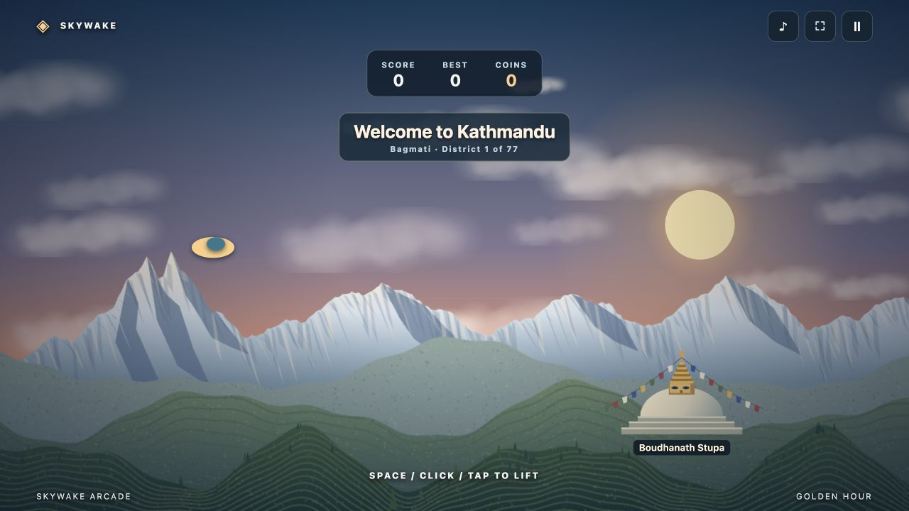

# चरी उड

A Canvas arcade game through Nepal’s 77 districts.



Open `Skywake.html` in a modern browser to play offline. The self-contained file can be copied to another computer. Each launch opens pilot setup. The name and optional cropped photo are stored in the browser. Browser storage policies determine whether profiles and records persist when the file is opened directly.

The local web version stores records and settings per browser and origin. Start it from this folder with:

```sh
python3 -m http.server 8765 --bind 127.0.0.1 --directory dist
```

Open http://127.0.0.1:8765/. Space, click, or tap to lift. Use P or Esc to pause.

## Visual Studio Code

Open this folder in VS Code. Use **Tasks: Run Task → Run चरी उड** to start the local game server, and **Tasks: Run Build Task** to regenerate the standalone HTML file. If the game is already running on port 8765, open the existing local page.

## Source

- `dist/game.js` runs the fixed-step flight simulation, Canvas rendering, input, and menu state.
- `dist/scenery.js` generates and caches the Himalayan peaks, terraced hills, and stupa layers and draws the time-of-day cycle.
- `dist/districts.js` defines the 77 stops, and `dist/landmarks.js` draws each stop’s landmark.
- `dist/audio.js` synthesizes the soundtrack and effects with Web Audio.
- `dist/profile.js` handles player names, optional local photos, and the adjustable portrait crop.
- `tools/package.py` builds the standalone file using Python’s standard library.

The game requires no network assets or runtime dependencies.

## Nepal tour

The tour starts in Kathmandu, crosses into Nuwakot, and visits all 77 districts once. Each successive pair shares a boundary in [Acesmndr's Nepal GeoJSON dataset](https://github.com/Acesmndr/nepal-geojson/tree/master/generated-geojson), checked by matching boundary segments. The route represents an arcade flight over districts. Gate spacing does not represent real mileage.

Clear three gates to cross into the next district and save a checkpoint in the browser. The Nepal route screen lets players replay districts they have reached. The Canvas artwork depicts stylized monuments and natural landmarks. References include the [Nepal Tourism Board's province guides](https://ntb.gov.np/en/provinces), [Lumbini's Tourism Development Council](https://tdc.lumbini.gov.np/pages/maindestinations), and the [Sudurpashchim tourism master plan](https://giwmscdnone.gov.np/media/pdf_upload/SP%20Tourism%20Master%20Plan%20Report%20-final_yutq4ev.pdf).
